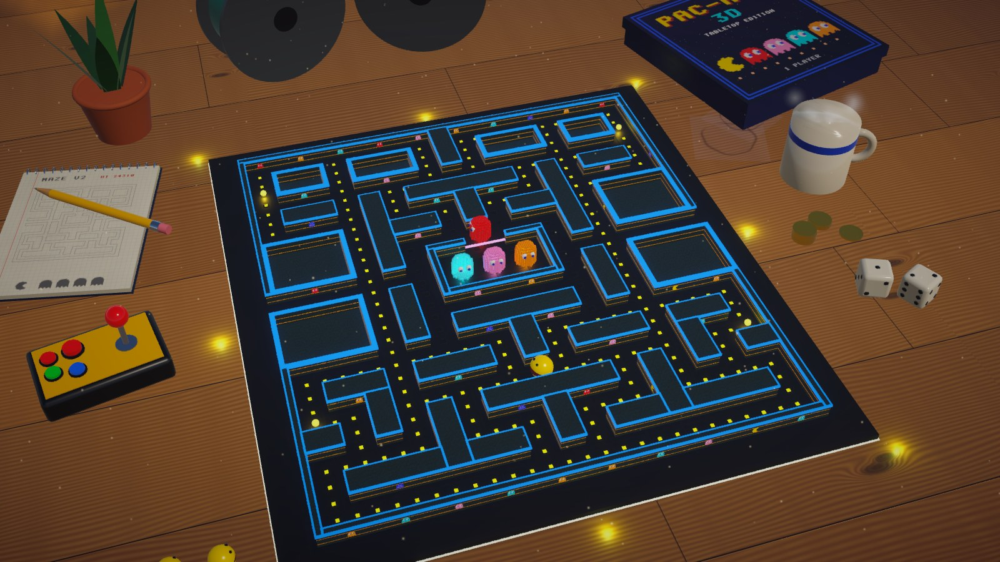
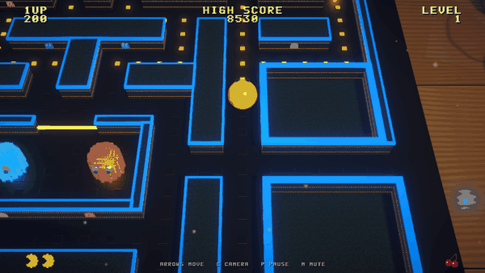
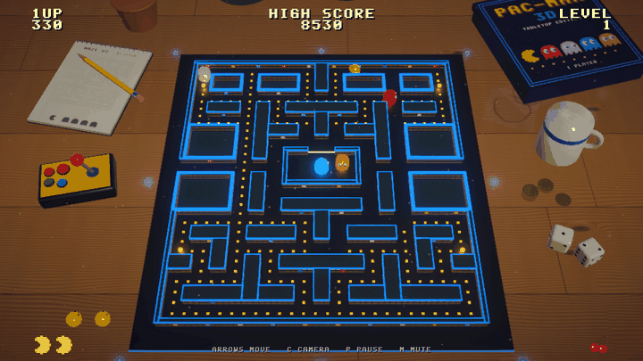
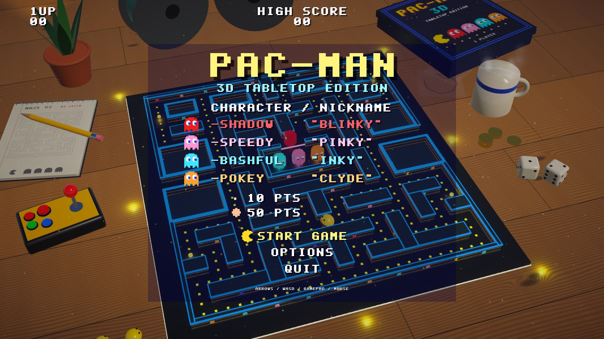
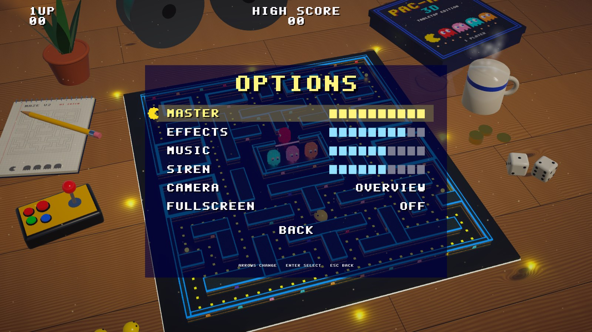
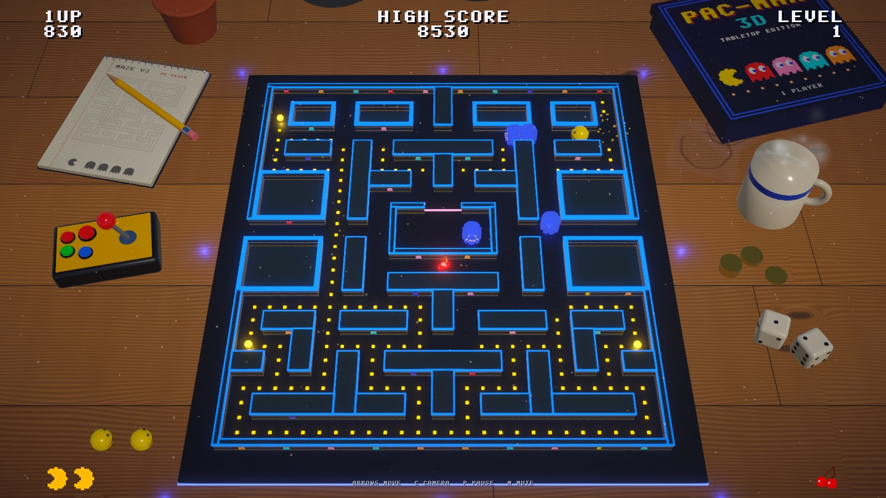
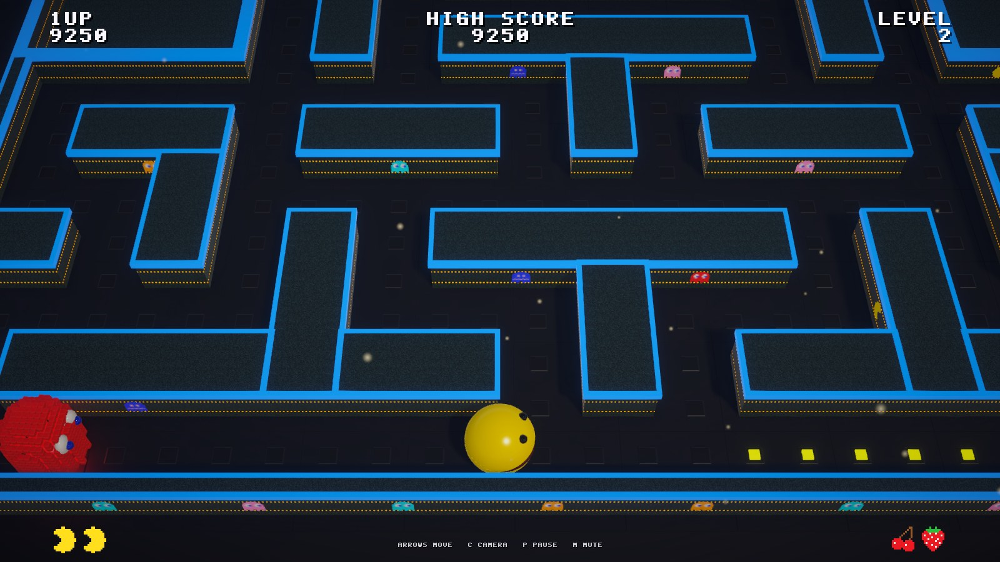
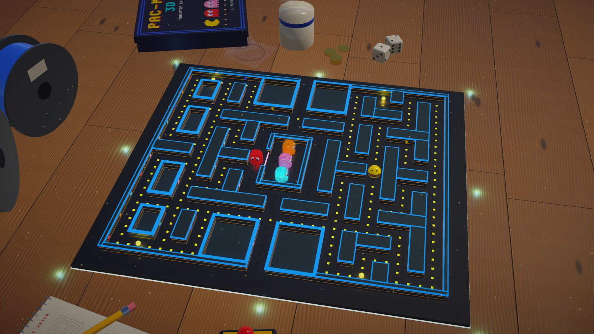
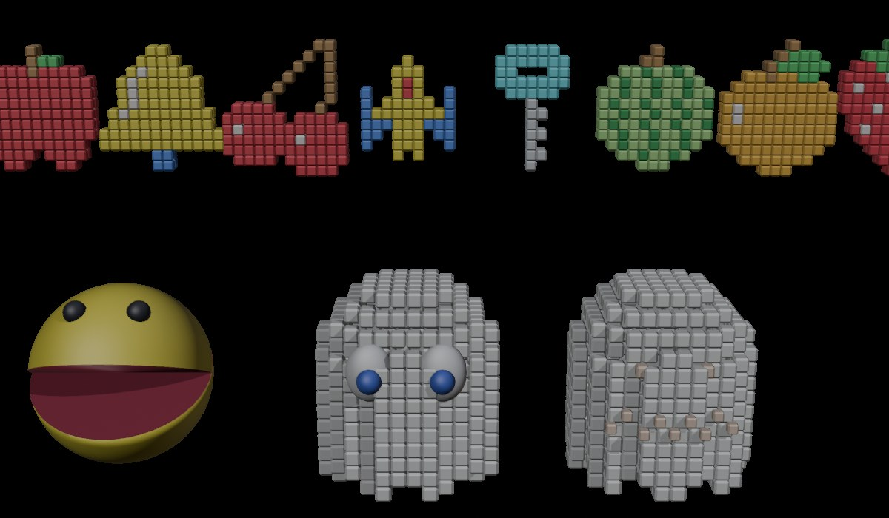

# Pac-Man 3D: Tabletop Edition

**Arcade Pac-Man, rebuilt in Unity as a 3D-printed maze on a sunny kitchen table.**

The rules follow the 1980 arcade machine closely: the four ghost personalities, the scatter/chase timing and the
speed tables. Around it sits a little diorama. The walls are glittery teal with blue rims, the pellets are yellow LEDs,
the ghosts are voxel prints, and the table has coffee, dice and an arcade stick that moves when you steer.



| Follow camera | Overview |
|---|---|
|  |  |

## Features

### The arcade game
- The 28x31 arcade maze with 240 dots, 4 energizers, the side tunnels and the ghost house.
- **Four ghost personalities**:
  - **Blinky** chases you directly.
  - **Pinky** aims four tiles ahead of you, including the arcade's "facing up" overflow bug.
  - **Inky** takes the vector from Blinky to a point ahead of you and doubles it.
  - **Clyde** backs off when he gets close.
- **Scatter/chase waves**, frightened time and flash counts per level, as in the arcade.
- Ghosts reverse on every mode change, and there are tiles above the ghost house where they may not turn up.
- **House release**: per-ghost dot counters, a global counter after you die, and an idle timer.
- **Cruise Elroy**: Blinky speeds up when few dots remain.
- **Arcade speed tables**:
  - per-level speeds for Pac-Man and the ghosts
  - ghosts slow down in the tunnels
  - Pac-Man loses a frame for every dot he eats
  - **cornering**: a buffered turn can be taken a little before or after the corner
- **Scoring**:
  - eaten ghosts give 200, 400, 800 and 1600 points
  - eight kinds of bonus fruit, from cherry to key
  - an extra life at 10,000
  - a saved high score
- **Game flow**:
  - an intro with "PLAYER ONE" and "READY!"
  - a death animation and a flashing maze when you clear a level
  - a title screen with the ghost line-up, and an AI that plays a demo game when you leave it idle

### The tabletop look
- **The walls are built from the maze layout in code.**
  - Large blocks become open-topped "planter" boxes, like the 3D-printed kits this is modelled on.
  - The walls are glittery and carry LED strips and pixel-art plaques.
  - Every block gets a blue rim.
- **Pac-Man, the voxel ghosts and the bonus fruit** are modelled by a headless **Blender** script.
  - The ghosts have two skirt frames, eyes that follow their direction, and a frightened face.
  - The fruit are extruded pixel art.
- **Lighting**:
  - The ghosts, energizers and fruit cast coloured light.
  - The post-processing adds bloom, tonemapping, a vignette and a light depth of field.

### A table that feels alive
- **Props**:
  - a steaming coffee mug with ring stains
  - spools of the "filament" the maze was printed with
  - the game box with its own box art
  - a notebook with a pencil sketch of the maze
  - dice, arcade tokens and a swaying snake plant
- **Light and air**: the sun shines through a window (a light cookie throws mullion shadows), clouds drift past, and dust floats in the light.
- **An LED underglow** under the board follows the game:
  - it breathes with the siren and turns blue when the ghosts are frightened
  - it flashes when you eat a ghost, goes red when you die and strobes when you clear a level
- **Your spare lives stand on the table** as little Pac-Man figures. They watch the action and cheer when you eat a ghost. When you lose a life, one hops onto the board.
- **The fruit you win** lines up beside the board.
- **The arcade stick** on the table tilts with your steering, and its button goes down when a game starts.

### Menus and sound
- **Menus**: a title menu, a pause menu and an **options** page.
  - Options: volume for master, effects, music and siren, the camera mode and fullscreen.
  - Everything is saved between sessions.
  - Keyboard, gamepad and mouse all work.
- **All sound is synthesised in code**: the chomp, the siren, frightened and eyes-returning loops, death and fruit, and an original intro jingle and title tune.

## Screenshots

| | |
|---|---|
|  |  |
|  |  |
|  |  |

## Playing it

Requirements: **Unity 6.6** (6000.6.5f1) with the Universal Render Pipeline. Everything else is in the repo.

1. Open the project folder in Unity Hub.
2. Open `Assets/Scenes/PacMan3D.unity` and press **Play**.
3. To get a standalone game, use the menu **Pac-Man > Build Windows Player**. It writes `Builds/Windows/PacMan3D.exe`.

| | Keyboard | Gamepad |
|---|---|---|
| Move / menu navigation | Arrows or WASD | D-pad or left stick |
| Select | Enter or Space | A or Start |
| Pause menu | P or Esc | Start |
| Back | Esc or Backspace | B or Select |
| Overview / follow camera | C | Y |
| Mute | M | |

## How it is made

Nearly everything is generated by code, so the whole look can be rebuilt from scratch.

| Part | Where | How |
|---|---|---|
| Game rules | `Assets/Scripts/Core` | Pure C# with no Unity scene objects (`GameSim`, `Maze`, `LevelSpec`, `Autopilot`). Covered by NUnit tests in `Assets/Tests/EditMode`. |
| 3D view, HUD, menus, sound | `Assets/Scripts/Game` | Mirrors the simulation onto the board. The pixel-font HUD is drawn with `Graphics.DrawTexture`, and the audio is synthesised at startup. |
| Characters and fruit | `Blender/build_models.py` | Headless Blender; voxel ghosts, hinged Pac-Man jaws, extruded pixel-art fruit, exported as FBX. |
| Table props | `Blender/build_props.py` | Mug, spools, arcade stick, game box, notebook, dice, tokens, plant. |
| Textures, materials, scene | `Assets/Scripts/Editor/ProjectSetup.cs` | Procedural glitter, LED strips, floor sockets, oak table, box art and the maze sketch, then the URP materials, the post-processing profile and the scene. |
| Screenshots | `Assets/Scripts/Editor/Snapshots.cs` | Renders the game to PNG in batch mode, without entering play mode. |

```bash
# Rebuild the models
blender -b --factory-startup --python Blender/build_models.py
blender -b --factory-startup --python Blender/build_props.py

# Rebuild textures, materials and the scene (also: menu Pac-Man > Setup Project)
Unity -batchmode -projectPath . -executeMethod PacMan.EditorTools.ProjectSetup.RunBatch -quit

# Run the tests
Unity -batchmode -projectPath . -runTests -testPlatform EditMode -testResults results.xml

# Render screenshots (also: menu Pac-Man > Render Snapshots)
Unity -batchmode -projectPath . -executeMethod PacMan.EditorTools.Snapshots.RunBatch -snapshotDir Snapshots
```

The built game also accepts `-autoplay` (the AI plays), `-camera follow`, `-mute`, `-shots <dir>` and
`-record <dir> <startSeconds> <frames>`. The GIFs above were recorded with `-record`.

## Credits

- A fan project, made for fun and learning. It is not affiliated with or endorsed by Bandai Namco.
- PAC-MAN is a trademark of Bandai Namco Entertainment Inc.
- The maze layout and the rules follow the original arcade game.
- All models, textures, pixel art, sounds and music are original. They are generated by the code in this repository.
- The look was inspired by a photo of a 3D-printed tabletop Pac-Man maze.
- Developed by Magnus Eriksson together with [Claude Code](https://claude.com/claude-code).
